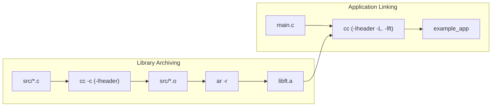

# Libft — 42 Cursus

A custom C standard library implementation re-engineering essential libc utilities, memory manipulation routines, string handling algorithms, and Unix file descriptor I/O.

<p align="center">
  
  
  
  
  
  
</p>

## Project Information

| Item | Details |
|---|---|
| **Language** | C (C99-compatible standard syntax) |
| **Compiler & Flags** | `cc` with `-Wall -Wextra -Werror` |
| **School** | 1337 Coding School (Khouribga) — 42 Network |
| **Target Output** | `libft.a` (Static Library Archive) |
| **Build System** | GNU Make (`cc`, `ar`) |
| **Functions Implemented** | 34 (23 Part 1 Libc + 11 Part 2 Additional) |
| **Bonus Part (Linked Lists)** | Not implemented in this repository (0 / 9 functions) |
| **Documentation Hub** | [`docs/README.md`](docs/README.md) |
| **Author** | Ayman Saadane ([@Shifuuu31](https://github.com/Shifuuu31)) |

---

## Documentation

Explore the comprehensive documentation suite:

- **[Documentation Home (docs/README.md)](docs/README.md)**: Central knowledge base, learning paths, and quick navigation.
- **[Function Reference (docs/FUNCTIONS.md)](docs/FUNCTIONS.md)**: Searchable technical reference for all 34 functions.
- **[Implementation Guide (docs/IMPLEMENTATION.md)](docs/IMPLEMENTATION.md)**: Low-level systems concepts, pointer mechanics, and memory models.
- **[Testing Guide (docs/TESTING.md)](docs/TESTING.md)**: Build targets, test runner setup, and edge-case matrix.
- **[Documentation Standard (docs/PROJECT_DOCUMENTATION_STANDARD.md)](docs/PROJECT_DOCUMENTATION_STANDARD.md)**: Reusable engineering documentation conventions.

### Quick Access

Jump directly to essential sections:
- [Installation](#8-installation)
- [Compilation](#9-compilation)
- [Makefile Commands](#10-makefile-commands)
- [Usage Instructions](#11-usage-instructions)
- [Working C Example](#12-complete-working-c-example)
- [Function Categories](#4-features-implemented-categories)
- [Testing Instructions](#14-testing-instructions)
- [Known Limitations](#15-known-limitations-technical-observations)
- [Author](#author)
- [License & Academic Context](#license-academic-context)

---

## 1. Introduction

`libft` is the foundational project of the 42 coding school curriculum. It challenges software engineers to implement core C standard library functions from scratch without relying on existing standard libraries or third-party packages. The result is `libft.a`, a self-contained static archive that serves as the bedrock utility library for subsequent systems programming assignments (such as `ft_printf`, `get_next_line`, `push_swap`, `minishell`, and `philosophers`).

---

## 2. Project Overview

In C systems programming, understanding what happens under the abstraction layer of the standard library is essential. Libft rebuilds standard memory blocks, character checks, integer-to-string conversions, dynamic string slices, and Unix descriptor writers.

This repository implements the mandatory 34 functions specified in the 42 Libft subject, organized cleanly into modular source and header directories.

---

## 3. Objectives and Learning Outcomes

- **Low-Level Memory Management**: Understanding byte-level addressing, memory allocation (`malloc`), deallocation (`free`), and memory safety.
- **Pointer Manipulation & Arithmetic**: Working directly with raw pointers (`void *`, `char *`, `unsigned char *`) and multi-level indirection (`char **`).
- **Data Representation**: Handling two's complement integer limits, ASCII encoding, null terminators, and buffer boundaries.
- **Defensive Engineering**: Managing edge cases, buffer bounds, memory leaks, and error rollback.
- **Build Automation**: Creating maintainable Makefiles, managing object artifacts, and archiving static libraries with `ar`.

---

## 4. Features & Implemented Categories

The library contains 34 functions categorized into 8 functional modules:

```text
Libft (34 functions)
├── 1. Character Classification & Conversion (7 functions)
│   └── ft_isalpha, ft_isdigit, ft_isalnum, ft_isascii, ft_isprint, ft_toupper, ft_tolower
├── 2. Raw Memory Manipulation (6 functions)
│   └── ft_memset, ft_bzero, ft_memcpy, ft_memmove, ft_memchr, ft_memcmp
├── 3. Dynamic Memory Allocation (1 function)
│   └── ft_calloc
├── 4. String Length, Searching & Comparison (5 functions)
│   └── ft_strlen, ft_strncmp, ft_strchr, ft_strrchr, ft_strnstr
├── 5. String Sizing & Bounded Copying (2 functions)
│   └── ft_strlcpy, ft_strlcat
├── 6. String Creation, Slicing & Transformation (7 functions)
│   └── ft_strdup, ft_substr, ft_strjoin, ft_strtrim, ft_split, ft_strmapi, ft_striteri
├── 7. Integer & String Conversions (2 functions)
│   └── ft_atoi, ft_itoa
└── 8. File Descriptor Output (4 functions)
    └── ft_putchar_fd, ft_putstr_fd, ft_putendl_fd, ft_putnbr_fd
```

For complete per-function documentation, see [docs/FUNCTIONS.md](docs/FUNCTIONS.md).

---

## 5. Technology Stack

- **Language**: C (C99-compatible standard syntax, avoiding restricted qualifiers)
- **Compiler**: `cc` (supports GCC and Clang)
- **Default Flags**: `-Wall -Wextra -Werror`
- **Archiver**: GNU `ar` (`ar -r`)
- **Target Architecture**: Unix-like environments (Linux / macOS)

---

## 6. Repository Structure

```text
Libft_42-cursus/
├── Makefile                          # Build configuration script
├── README.md                         # Main repository documentation
├── en.subject.pdf                    # Official 42 curriculum specification
├── header/
│   └── libft.h                       # Primary header with prototypes and system includes
├── src/                              # Source code (34 .c implementations)
│   ├── ft_atoi.c
│   ├── ft_bzero.c
│   ├── ft_calloc.c
│   ├── ft_isalnum.c
│   ├── ft_isalpha.c
│   ├── ft_isascii.c
│   ├── ft_isdigit.c
│   ├── ft_isprint.c
│   ├── ft_itoa.c
│   ├── ft_memchr.c
│   ├── ft_memcmp.c
│   ├── ft_memcpy.c
│   ├── ft_memmove.c
│   ├── ft_memset.c
│   ├── ft_putchar_fd.c
│   ├── ft_putendl_fd.c
│   ├── ft_putnbr_fd.c
│   ├── ft_putstr_fd.c
│   ├── ft_split.c
│   ├── ft_strchr.c
│   ├── ft_strdup.c
│   ├── ft_striteri.c
│   ├── ft_strjoin.c
│   ├── ft_strlcat.c
│   ├── ft_strlcpy.c
│   ├── ft_strlen.c
│   ├── ft_strmapi.c
│   ├── ft_strncmp.c
│   ├── ft_strnstr.c
│   ├── ft_strrchr.c
│   ├── ft_strtrim.c
│   ├── ft_substr.c
│   ├── ft_tolower.c
│   └── ft_toupper.c
├── tests/
│   └── validate_docs.py              # Automated documentation graph validator
└── docs/
    ├── README.md                     # Central documentation hub & learning paths
    ├── FUNCTIONS.md                  # Comprehensive function reference
    ├── IMPLEMENTATION.md             # Low-level systems and memory concepts
    ├── TESTING.md                    # Test setup, edge-case matrix, and quality guide
    └── PROJECT_DOCUMENTATION_STANDARD.md # Reusable documentation standard
```

---

## 7. Prerequisites

- A Unix-compatible operating system (Linux or macOS).
- A C compiler (`cc`, `gcc`, or `clang`).
- GNU `make` utility.
- GNU `ar` archive utility.

---

## 8. Installation

Clone this repository to your local workstation:

```bash
git clone https://github.com/Shifuuu31/Libft_42-cursus.git
cd Libft_42-cursus
```

---

## 9. Compilation

To compile all source files and generate the static library `libft.a`:

```bash
make CFLAGS="-Wall -Wextra -Werror -Iheader -I."
```

> **Note on Include Paths**: The source files in `src/` use relative includes (`#include "libft.h"`). Passing `-Iheader -I.` supplies the necessary include paths for compilation. See [Known Limitations](#15-known-limitations-technical-observations) for details.

---

## 10. Makefile Commands

The `Makefile` supports the four standard 42 rules:

| Target | Command | Description |
|---|---|---|
| `all` | `make all CFLAGS="-Wall -Wextra -Werror -Iheader -I."` | Compiles `.o` objects and creates `libft.a`. |
| `clean` | `make clean` | Deletes intermediate object files (`src/*.o`). |
| `fclean` | `make fclean` | Deletes object files and the generated `libft.a`. |
| `re` | `make re CFLAGS="-Wall -Wextra -Werror -Iheader -I."` | Rebuilds the entire library from scratch. |

---

## 11. Usage Instructions

Using Libft in an external C application involves four discrete steps:

1. **Build the Library**: Run `make` to compile the source files into the static archive `libft.a`.
2. **Include the Header**: Add `#include "libft.h"` to your C source code to expose the function prototypes.
3. **Link the Static Library**: During compilation, specify `-Iheader` for header resolution, `-L.` to designate the library search directory, and `-lft` to link `libft.a`.
4. **Run the Executable**: Execute the generated binary.



---

## 12. Complete Working C Example

Below is a complete, standalone C program (`main.c`) demonstrating string manipulation, memory allocation, number formatting, and file descriptor output using Libft:

```c
#include "libft.h"
#include <stdio.h>
#include <stdlib.h>

int main(void)
{
    char *text;
    char *copy;
    char *num_str;

    // 1. Duplicate a string
    text = ft_strdup("Hello from Libft!");
    if (!text)
        return (1);

    // 2. Concatenate strings
    copy = ft_strjoin(text, " Welcome to 42 Cursus.");
    if (!copy)
    {
        free(text);
        return (1);
    }

    // 3. Format an integer into a string
    num_str = ft_itoa(42);
    if (!num_str)
    {
        free(text);
        free(copy);
        return (1);
    }

    // 4. Print directly to standard output (file descriptor 1)
    ft_putstr_fd(copy, 1);
    ft_putchar_fd('\n', 1);
    ft_putstr_fd("Computed value: ", 1);
    ft_putendl_fd(num_str, 1);

    // 5. Clean up allocated heap memory
    free(text);
    free(copy);
    free(num_str);

    return (0);
}
```

### Building and Executing the Example

```bash
# 1. Compile the library archive
make CFLAGS="-Wall -Wextra -Werror -Iheader -I."

# 2. Compile and link the application
cc -Wall -Wextra -Werror -Iheader main.c -L. -lft -o example_app

# 3. Execute
./example_app
```

**Expected Output:**

```text
Hello from Libft! Welcome to 42 Cursus.
Computed value: 42
```

---

## 13. Documentation Links

- **[Documentation Home (docs/README.md)](docs/README.md)**: Central knowledge hub, navigation, and learning paths.
- **[Detailed Function Reference (docs/FUNCTIONS.md)](docs/FUNCTIONS.md)**: Exhaustive documentation for all 34 functions, including parameters, return values, ownership rules, and edge cases.
- **[Implementation & Architecture Concepts (docs/IMPLEMENTATION.md)](docs/IMPLEMENTATION.md)**: Deep dive into pointer arithmetic, memory overlap resolution, 2D array allocation recovery, integer conversion, and system calls.
- **[Testing & Quality Assurance Guide (docs/TESTING.md)](docs/TESTING.md)**: Step-by-step instructions on writing test runners, Valgrind leak checking, AddressSanitizer, and edge-case test matrices.
- **[Project Documentation Standard (docs/PROJECT_DOCUMENTATION_STANDARD.md)](docs/PROJECT_DOCUMENTATION_STANDARD.md)**: A reusable documentation framework for 42, systems programming, and modern language repositories.

---

## 14. Testing Instructions

The original Libft implementation was historically evaluated and passed during the 42 Cursus peer defense (100% score on the mandatory part). The updated repository layout and documentation have been verified locally with AddressSanitizer (clean heap execution with zero leaks and zero buffer errors) and automated link validation (`python3 tests/validate_docs.py`). However, the latest state has not undergone a fresh run against automated community test suites (such as Francinette or Tripouille) in this environment.

To compile and run tests against the library:

```bash
# Build the library
make CFLAGS="-Wall -Wextra -Werror -Iheader -I."

# Follow docs/TESTING.md to compile the custom test runner
cc -Wall -Wextra -Werror -Iheader tests/test_runner.c -L. -lft -o test_runner
./test_runner
```

To run memory leak checks with Valgrind:

```bash
valgrind --leak-check=full --show-leak-kinds=all --track-origins=yes ./test_runner
```

For complete testing patterns, refer to [docs/TESTING.md](docs/TESTING.md).

---

## 15. Known Limitations & Technical Observations

The project audit identified the following implementation details:

1. **Makefile Include Path**: The `Makefile` relies on `CFLAGS = -Wall -Wextra -Werror` without an explicit `-Iheader` include path flag. Because most `.c` files specify `#include "libft.h"` while the header is located in `header/libft.h`, invoking plain `make` without overriding `CFLAGS` fails to locate the header. Passing `CFLAGS="-Wall -Wextra -Werror -Iheader -I."` resolves this.
2. **`ft_atoi` Integer Overflow**: `ft_atoi` accumulates results in a standard signed 32-bit `int`. Values exceeding `INT_MAX` or `INT_MIN` overflow without clamping or setting `errno`.
3. **`ft_split` on Empty String**: `ft_split` begins with `if (!*s) return (NULL);`. If passed an empty string `""`, it returns `NULL` rather than an empty `NULL`-terminated array `[NULL]`. Additionally, if a word allocation fails, the error rollback loop `while (j > 0)` decrements down to 1, leaving `p[0]` unfreed.
4. **`ft_putendl_fd` NULL Pointer Check**: Unlike `ft_putstr_fd` which contains `if (!s) return ;`, `ft_putendl_fd` calls `ft_strlen(s)` directly. Passing `NULL` causes a segmentation fault.
5. **`ft_strnstr` Haystack Check**: `ft_strnstr` evaluates `big[i]` before checking `i < len`. Passing `big = NULL` causes a segmentation fault even if `len == 0` (unless `little` is empty).
6. **`ft_calloc` Integer Multiplication**: `ft_calloc` does not guard against integer overflow in `count * size`.
7. **42 Turn-In Folder Layout**: The 42 subject requires all files to reside at the root of the repository. In this repository, files are organized into `src/` and `header/`, which is clean for development but deviates from strict root-level submission constraints.

---

## 16. Verification Status

In accordance with professional audit standards:

| Item | Status | Verification Notes |
|---|---|---|
| Library Compilation | **Verified** | Compiles cleanly with `-Wall -Wextra -Werror -Iheader -I.`. |
| Static Archive (`libft.a`) | **Verified** | Valid static archive generated with `ar -r`. |
| Example Application | **Verified** | Compiles, links with `libft.a`, and executes without error. |
| 42 Defense Evaluation | **Historically Passed** | Evaluated and validated during 42 Cursus curriculum defense. |
| 42 Norminette | **Unverified** | `norminette` is not installed on this host environment. |
| External 42 Test Suites | **Unverified** | Third-party suites (`francinette`, `tripouille`) were not re-run on this revision. |
| Bonus Part (`t_list`) | **Not Implemented** | Only mandatory Part 1 and Part 2 (34 functions) are implemented. |

---

## 17. Original 42 Subject Reference

The table below maps the repository's implementations to the official 42 Libft subject specifications:

| Subject Section | Required Components | Implemented Functions | Status |
|---|---|---|---|
| **Part 1 — Libc Functions** | Character, string, and memory functions identical to man | `ft_isalpha`, `ft_isdigit`, `ft_isalnum`, `ft_isascii`, `ft_isprint`, `ft_strlen`, `ft_memset`, `ft_bzero`, `ft_memcpy`, `ft_memmove`, `ft_strlcpy`, `ft_strlcat`, `ft_toupper`, `ft_tolower`, `ft_strchr`, `ft_strrchr`, `ft_strncmp`, `ft_memchr`, `ft_memcmp`, `ft_strnstr`, `ft_atoi`, `ft_calloc`, `ft_strdup` (23 functions) | **Complete** |
| **Part 2 — Additional Functions** | Specialized string manipulation, number formatting, and file descriptor writers | `ft_substr`, `ft_strjoin`, `ft_strtrim`, `ft_split`, `ft_itoa`, `ft_strmapi`, `ft_striteri`, `ft_putchar_fd`, `ft_putstr_fd`, `ft_putendl_fd`, `ft_putnbr_fd` (11 functions) | **Complete** |
| **Bonus Part — Linked Lists** | `t_list` structure and list utilities | `ft_lstnew`, `ft_lstadd_front`, `ft_lstsize`, `ft_lstlast`, `ft_lstadd_back`, `ft_lstdelone`, `ft_lstclear`, `ft_lstiter`, `ft_lstmap` (9 functions) | **Not Implemented** |

---

## Author

**Ayman Saadane**
- GitHub: [@Shifuuu31](https://github.com/Shifuuu31)

---

## License & Academic Context

This project was developed by **Ayman Saadane** as a student at **1337 Coding School (Khouribga)** within the **42 Network** curriculum.

- **Intellectual Property**: The source code implementations are the academic work of the author.
- **Academic Integrity**: 1337 and 42 Network projects are governed by strict peer-evaluation and anti-plagiarism policies. If you are a student currently working on Libft, please respect the Honor Code and use this repository as a learning reference rather than copying code.
- **Licensing Notice**: No formal open-source license (such as MIT or Apache) has been attached to this repository. All rights are reserved by the author.

---

**Navigation**
- [Documentation Home](docs/README.md)
- [Function Reference](docs/FUNCTIONS.md)
- [Implementation Guide](docs/IMPLEMENTATION.md)
- [Testing Guide](docs/TESTING.md)
- [Documentation Standard](docs/PROJECT_DOCUMENTATION_STANDARD.md)
