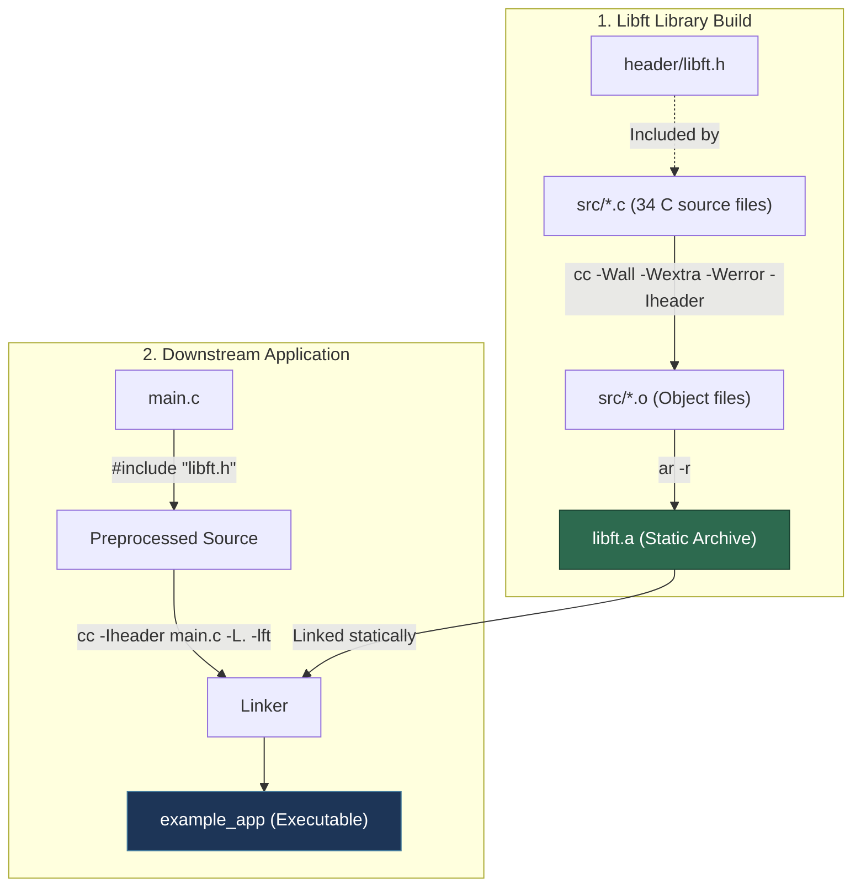

# Libft Documentation Index & Knowledge Base

Welcome to the central documentation index for `Libft_42-cursus`. This knowledge base is structured as an interconnected reference system designed to help developers quickly discover functions, understand low-level implementations, run tests, and integrate the library into downstream 42 projects.

---

## 1. Documentation Overview

The documentation is organized into specialized guides:

- **[Root README](../README.md)**: Project landing page, build instructions, quickstart guide, and working C code example.
- **[Function Reference (FUNCTIONS.md)](FUNCTIONS.md)**: Exhaustive technical manual for all 34 implemented functions.
- **[Implementation Guide (IMPLEMENTATION.md)](IMPLEMENTATION.md)**: Deep dive into pointer mechanics, memory layout, signedness, and systems concepts.
- **[Testing Guide (TESTING.md)](TESTING.md)**: Build targets, test harness creation, edge-case matrix, and leak detection.
- **[Documentation Standard (PROJECT_DOCUMENTATION_STANDARD.md)](PROJECT_DOCUMENTATION_STANDARD.md)**: Reusable documentation conventions for future repositories.
- **[Original Subject Specification](../en.subject.pdf)**: Official 42 curriculum project requirements.

---

## 2. Quick Navigation

Find relevant documentation by developer task:

| I want to... | Documentation Resource | Direct Link |
|---|---|---|
| Understand the library purpose & scope | Project Overview | [Project Overview](../README.md#2-project-overview) |
| Install prerequisites and compile `libft.a` | Build & Compilation | [Compilation Guide](../README.md#9-compilation) |
| Run an external C program with Libft | Usage & Working Example | [Usage Instructions](../README.md#11-usage-instructions) |
| Look up a function's prototype and behavior | Function Reference Manual | [Function Reference](FUNCTIONS.md) |
| Understand memory ownership and `free()` rules | Memory Management Concepts | [Dynamic Memory Allocation](IMPLEMENTATION.md#3-dynamic-memory-allocation-and-ownership) |
| Learn how `ft_memmove` handles overlap | Overlapping Buffer Resolution | [Memory Overlap Guide](IMPLEMENTATION.md#2-memory-overlap-safe-copying-ft_memcpy-vs-ft_memmove) |
| Write and run a test runner with edge cases | Testing & QA Guide | [Writing a Test Runner](TESTING.md#3-writing-a-custom-test-runner) |
| Check known technical limitations | Implementation Audit | [Known Limitations](../README.md#15-known-limitations-technical-observations) |
| Review the official 42 assignment subject | Curriculum PDF | [en.subject.pdf](../en.subject.pdf) |
| View validation evidence and test captures | Validation Evidence | [Validation Evidence](../README.md#validation-evidence) |
| Apply these documentation conventions elsewhere | Documentation Standard | [Documentation Standard](PROJECT_DOCUMENTATION_STANDARD.md) |

---

## 3. Function Category Index

Every one of the 34 functions implemented in this library is categorized below with direct links to its dedicated documentation entry in `FUNCTIONS.md`:

| Category | Function Count | Implemented Functions (Direct Links) |
|---|---|---|
| **Character Checks & Conversion** | 7 | [ft_isalpha](FUNCTIONS.md#ft_isalpha), [ft_isdigit](FUNCTIONS.md#ft_isdigit), [ft_isalnum](FUNCTIONS.md#ft_isalnum), [ft_isascii](FUNCTIONS.md#ft_isascii), [ft_isprint](FUNCTIONS.md#ft_isprint), [ft_toupper](FUNCTIONS.md#ft_toupper), [ft_tolower](FUNCTIONS.md#ft_tolower) |
| **Raw Memory Manipulation** | 6 | [ft_memset](FUNCTIONS.md#ft_memset), [ft_bzero](FUNCTIONS.md#ft_bzero), [ft_memcpy](FUNCTIONS.md#ft_memcpy), [ft_memmove](FUNCTIONS.md#ft_memmove), [ft_memchr](FUNCTIONS.md#ft_memchr), [ft_memcmp](FUNCTIONS.md#ft_memcmp) |
| **Dynamic Memory Allocation** | 1 | [ft_calloc](FUNCTIONS.md#ft_calloc) |
| **String Examination & Search** | 5 | [ft_strlen](FUNCTIONS.md#ft_strlen), [ft_strncmp](FUNCTIONS.md#ft_strncmp), [ft_strchr](FUNCTIONS.md#ft_strchr), [ft_strrchr](FUNCTIONS.md#ft_strrchr), [ft_strnstr](FUNCTIONS.md#ft_strnstr) |
| **String Sizing & Bounded Copy** | 2 | [ft_strlcpy](FUNCTIONS.md#ft_strlcpy), [ft_strlcat](FUNCTIONS.md#ft_strlcat) |
| **String Creation & Slicing** | 7 | [ft_strdup](FUNCTIONS.md#ft_strdup), [ft_substr](FUNCTIONS.md#ft_substr), [ft_strjoin](FUNCTIONS.md#ft_strjoin), [ft_strtrim](FUNCTIONS.md#ft_strtrim), [ft_split](FUNCTIONS.md#ft_split), [ft_strmapi](FUNCTIONS.md#ft_strmapi), [ft_striteri](FUNCTIONS.md#ft_striteri) |
| **Integer & String Conversions** | 2 | [ft_atoi](FUNCTIONS.md#ft_atoi), [ft_itoa](FUNCTIONS.md#ft_itoa) |
| **File Descriptor Output** | 4 | [ft_putchar_fd](FUNCTIONS.md#ft_putchar_fd), [ft_putstr_fd](FUNCTIONS.md#ft_putstr_fd), [ft_putendl_fd](FUNCTIONS.md#ft_putendl_fd), [ft_putnbr_fd](FUNCTIONS.md#ft_putnbr_fd) |

---

## 4. Alphabetical Function Index

Quick lookup for all 34 functions:

- **A**: [ft_atoi](FUNCTIONS.md#ft_atoi)
- **B**: [ft_bzero](FUNCTIONS.md#ft_bzero)
- **C**: [ft_calloc](FUNCTIONS.md#ft_calloc)
- **I**: [ft_isalnum](FUNCTIONS.md#ft_isalnum), [ft_isalpha](FUNCTIONS.md#ft_isalpha), [ft_isascii](FUNCTIONS.md#ft_isascii), [ft_isdigit](FUNCTIONS.md#ft_isdigit), [ft_isprint](FUNCTIONS.md#ft_isprint), [ft_itoa](FUNCTIONS.md#ft_itoa)
- **M**: [ft_memchr](FUNCTIONS.md#ft_memchr), [ft_memcmp](FUNCTIONS.md#ft_memcmp), [ft_memcpy](FUNCTIONS.md#ft_memcpy), [ft_memmove](FUNCTIONS.md#ft_memmove), [ft_memset](FUNCTIONS.md#ft_memset)
- **P**: [ft_putchar_fd](FUNCTIONS.md#ft_putchar_fd), [ft_putendl_fd](FUNCTIONS.md#ft_putendl_fd), [ft_putnbr_fd](FUNCTIONS.md#ft_putnbr_fd), [ft_putstr_fd](FUNCTIONS.md#ft_putstr_fd)
- **S**: [ft_split](FUNCTIONS.md#ft_split), [ft_strchr](FUNCTIONS.md#ft_strchr), [ft_strdup](FUNCTIONS.md#ft_strdup), [ft_striteri](FUNCTIONS.md#ft_striteri), [ft_strjoin](FUNCTIONS.md#ft_strjoin), [ft_strlcat](FUNCTIONS.md#ft_strlcat), [ft_strlcpy](FUNCTIONS.md#ft_strlcpy), [ft_strlen](FUNCTIONS.md#ft_strlen), [ft_strmapi](FUNCTIONS.md#ft_strmapi), [ft_strncmp](FUNCTIONS.md#ft_strncmp), [ft_strnstr](FUNCTIONS.md#ft_strnstr), [ft_strrchr](FUNCTIONS.md#ft_strrchr), [ft_strtrim](FUNCTIONS.md#ft_strtrim), [ft_substr](FUNCTIONS.md#ft_substr)
- **T**: [ft_tolower](FUNCTIONS.md#ft_tolower), [ft_toupper](FUNCTIONS.md#ft_toupper)

---

## 5. Learning Paths

Follow a tailored reading sequence based on your technical objective:

### Path A: New to the Project
1. **[Project Overview](../README.md#2-project-overview)**: Understand the goals and curriculum context.
2. **[Official Requirements](../en.subject.pdf)**: Review Part 1 and Part 2 constraints.
3. **[Installation & Compilation](../README.md#9-compilation)**: Build `libft.a` locally.
4. **[Complete Usage Example](../README.md#12-complete-working-c-example)**: See how an external program links to `libft.a`.
5. **[Function Reference](FUNCTIONS.md)**: Explore the available API.

### Path B: Understanding Low-Level Systems Concepts
1. **[Implementation Guide](IMPLEMENTATION.md)**: Study byte addressing, memory overlap, and signedness.
2. **[Memory Ownership & 2D Freeing](IMPLEMENTATION.md#4-multi-allocation-error-recovery-the-2d-array-pattern)**: Learn how `ft_split` allocates and tears down dynamic arrays.
3. **[Two's Complement & INT_MIN](IMPLEMENTATION.md#6-twos-complement-integer-representation-int_min)**: Understand integer negation edge cases.
4. **[Source Code](../src/)**: Read the raw `.c` implementations with full context.

### Path C: Testing & Quality Assurance
1. **[Makefile Targets](TESTING.md#2-makefile-targets)**: Learn the build rules (`all`, `clean`, `fclean`, `re`).
2. **[Custom Test Runner](TESTING.md#3-writing-a-custom-test-runner)**: Set up an assertion-based test runner.
3. **[Edge-Case Matrix](TESTING.md#5-systematic-edge-case-matrix)**: Review boundary conditions for each function.
4. **[Memory Leak Detection](TESTING.md#6-memory-leak-detection-valgrind-asan)**: Verify clean execution under AddressSanitizer or Valgrind.

---

## 6. Library Build & Linking Pipeline

The diagram below illustrates how source files transform from translation units into the static archive `libft.a` and link with an external C application:

---

**Navigation**
- [Documentation Home](README.md)
- [Project README](../README.md)
- [Function Reference](FUNCTIONS.md)
- [Implementation Guide](IMPLEMENTATION.md)
- [Testing Guide](TESTING.md)
- [Documentation Standard](PROJECT_DOCUMENTATION_STANDARD.md)
